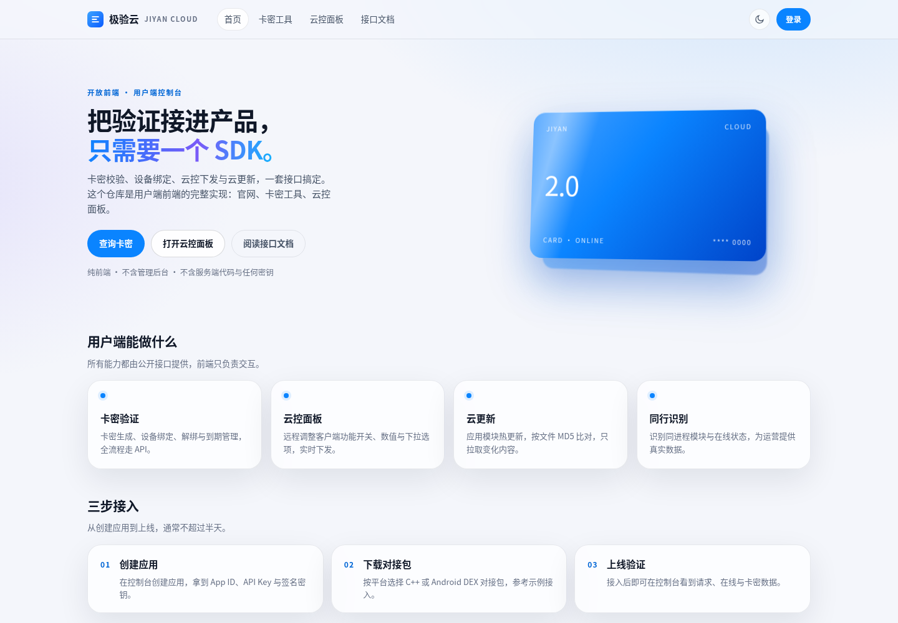
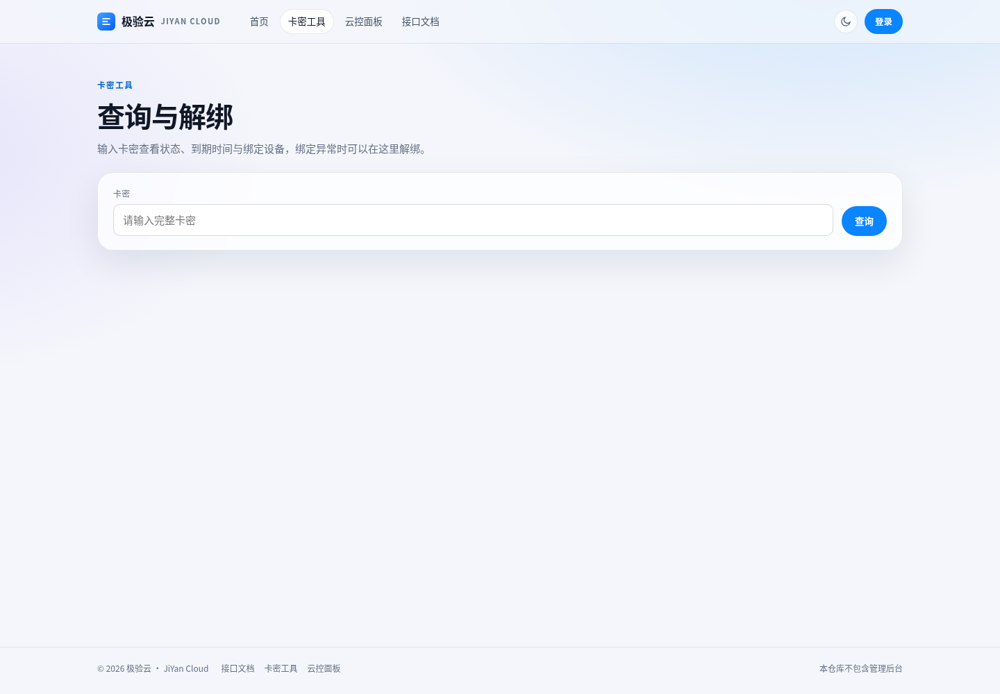

# 极验云 · 用户端前端

[](LICENSE)
[](https://github.com/KunKun24/jiyan-web/actions/workflows/ci.yml)
[](https://vuejs.org/)
[](https://nodejs.org/)

极验云（JiYan Cloud）的**用户端前端**：官网首页、卡密查询与解绑工具、云控面板、开发者登录。

> 本仓库只包含用户端页面。**不包含管理后台**，也不包含服务端代码、数据库结构、签名密钥或任何部署凭据。所有请求都走官方公开接口。





[English](README.en.md) · [部署说明](docs/zh/deploy.md) · [接口协议](docs/zh/protocol.md) · [常见问题](docs/zh/faq.md)

## 功能

- **官网首页**：产品介绍、能力概览、接入流程与入口聚合。
- **卡密工具**：输入卡密查询状态、到期时间、绑定设备与解绑额度；支持应用范围内解绑。
- **云控面板**：选择应用后打开用户端云控，编辑功能开关/数值/下拉项并下发，支持恢复默认与一次性指令。
- **登录与会话**：使用平台账号登录，云控面板依赖登录态。
- **深色模式与响应式布局**：桌面与移动端均可使用。

## 技术栈

- Vue 3 + TypeScript + Vite
- Vue Router（history 模式）
- 原生 CSS（设计 token、玻璃拟态、深浅色）
- Vitest（协议层单元测试）

## 快速开始

```bash
npm install
npm run dev      # 本地开发，默认代理到官网
npm run build    # 类型检查 + 生产构建
npm run test     # 协议层测试
```

本地开发时，Vite 会把 `/api` 与 `/cloud-control.php` 代理到 `JIYAN_DEV_TARGET`（默认 `https://jiyan.xn--0try77c6um82w.cn`）。也可以通过环境变量覆盖：

```bash
JIYAN_DEV_TARGET=https://your-staging.example npm run dev
```

## 部署

前端请求依赖**同源 Cookie**（登录态、云控面板会话），因此必须与 API 部署在同一站点下：

```bash
npm ci
npm run build
# 将 dist/ 作为站点根目录发布，并让 /api 反向代理到后端
```

Nginx 参考：

```nginx
server {
    listen 443 ssl http2;
    server_name your-domain.example;

    root /var/www/jiyan-web/dist;
    index index.html;

    location / {
        try_files $uri $uri/ /index.html;
    }

    location /api/ {
        proxy_pass https://your-backend.example;
        proxy_set_header Host $host;
        proxy_set_header X-Real-IP $remote_addr;
    }
}
```

完整说明与常见坑见 [部署说明](docs/zh/deploy.md)。

## 目录结构

```
src/
  api/          账号、公开工具、云控接口封装
  components/   页头、Toast 等通用组件
  lib/          ENV 传输协议、HTTP 封装、格式化
  stores/       登录态
  styles/       设计 token 与全局样式
  views/        首页 / 卡密 / 登录 / 云控 / 404
tests/          协议层单元测试
docs/           中英文部署与协议说明
```

## 接口边界

- 公开工具：`web_card_query`、`web_unbind`（无需登录，服务端按 IP 限流）。
- 账号接口：`/api/账号接口入口.php` 的 `login`、`me`、`logout`。
- 云控接口：`open_cloud_control` 获取面板链接，面板会话建立后调用 `/api/env/cloud-control.php`。

详细字段与示例见 [接口协议](docs/zh/protocol.md)。

## 安全

- 前端不保存密码，不内置任何密钥；会话由服务端 HttpOnly Cookie 管理。
- ENV 传输是编码层，不是加密层，必须配合 HTTPS。
- 发现安全问题请按 [SECURITY.md](SECURITY.md) 私下报告，不要提交公开 Issue。

## 相关仓库

- [jiyan-sdk-cpp](https://github.com/KunKun24/jiyan-sdk-cpp)：C++ 客户端 SDK
- [jiyan-sdk-android](https://github.com/KunKun24/jiyan-sdk-android)：Android DEX 壳与组件 SDK
- 官方文档：<https://jiyan.xn--0try77c6um82w.cn/docs.html>

## 许可证

[AGPL-3.0-only](LICENSE)。你可以自部署与修改，但向公众提供修改后的服务时需按 AGPL 公开对应源码。

## 声明

本项目与 GEETEST（极验）无关，「极验云 / JiYan Cloud」为独立产品名称。仓库内容按现状提供，不附带任何明示或暗示担保。
